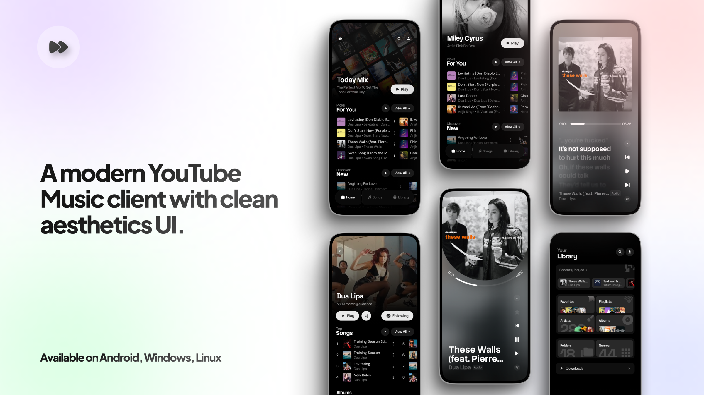

# Looper Music v3.0.1

A fixes release: smoother back navigation, faster animated artwork, a lighter home widget and APKs that always install over each other.

  

## Download

Not sure which phone type you have? Take `arm64-v8a`.

| Phone type | APK |
|---|---|
| `arm64-v8a` (most phones) | [Download](https://github.com/devvlooper/LooperMusic/releases/download/3.0.1/looper-player-v3.0.1-arm64-v8a-online-release.apk) |
| `armeabi-v7a` | [Download](https://github.com/devvlooper/LooperMusic/releases/download/3.0.1/looper-player-v3.0.1-armeabi-v7a-online-release.apk) |
| `x86_64` | [Download](https://github.com/devvlooper/LooperMusic/releases/download/3.0.1/looper-player-v3.0.1-x86_64-online-release.apk) |
| `universal` | [Download](https://github.com/devvlooper/LooperMusic/releases/download/3.0.1/looper-player-v3.0.1-universal-online-release.apk) |

## What's New

### New
- Album pages have an Add to playlist button in place of Download: add the whole album to a playlist, or make a new playlist named after it

### Improved
- Animated artwork set to "Apple, then YouTube" now shows the YouTube video within seconds, instead of waiting for every Apple lookup to finish first
- Home screen widgets use less battery while music plays: only the widgets on your home screen refresh, and the artwork is no longer reloaded every few seconds

### Fixed
- Back from an online artist or album page now goes back one step instead of jumping to Home
- A slow or dropped connection no longer hides an album's Apple motion artwork for 30 days
- Removed View All from Home's Picks For You, which opened the Songs tab
- "App not installed" when installing the universal APK over the arm64 one (or any other mix): every APK now shares one version code, so any APK installs over any older one

## Support

If you enjoy Looper, you can support us on Ko-fi:

## Notes

This release is distributed through GitHub and Play Store. Verify downloads with the `SHA256SUMS-v3.0.1.txt` file.

**Full Changelog**: https://github.com/devvlooper/LooperMusic/compare/3.0.0...3.0.1
