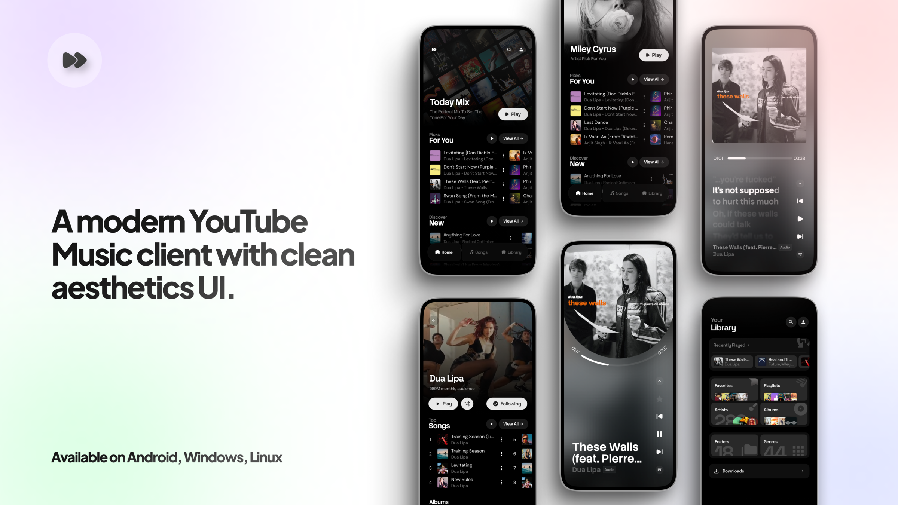

# Looper Music v3.0.2

A battery and smoothness release: a much lighter music bar, steadier animated artwork and a quick way to queue songs.

  

## Download

Not sure which phone type you have? Take `arm64-v8a`.

| Phone type | APK |
|---|---|
| `arm64-v8a` (most phones) | [Download](https://github.com/devvlooper/LooperMusic/releases/download/3.0.2/looper-player-v3.0.2-arm64-v8a-online-release.apk) |
| `armeabi-v7a` | [Download](https://github.com/devvlooper/LooperMusic/releases/download/3.0.2/looper-player-v3.0.2-armeabi-v7a-online-release.apk) |
| `x86_64` | [Download](https://github.com/devvlooper/LooperMusic/releases/download/3.0.2/looper-player-v3.0.2-x86_64-online-release.apk) |
| `universal` | [Download](https://github.com/devvlooper/LooperMusic/releases/download/3.0.2/looper-player-v3.0.2-universal-online-release.apk) |

## What's New

### New
- Album, artist and collection lists: while a song is loaded, the track number becomes an add-to-queue button. Tap again to remove the song

### Improved
- Lower battery use while music plays: the music bar now shows a still cover, and artwork videos pause while they are off screen
- Long titles scroll once per song, then rest
- The Home banner only advances while it is on screen
- New installs start with animated artwork on Always, using Apple then YouTube, and with Blur Background on
- A stronger, smoother Now Playing background blur

### Fixed
- Animated artwork stopping a few seconds after it first loaded
- Streaming video artwork getting stuck while buffering until the song was reopened
- Fine lines across the blurred Now Playing background

## Support

If you enjoy Looper, you can support us on Ko-fi:

## Notes

This release is distributed through GitHub and Play Store. Verify downloads with the `SHA256SUMS-v3.0.2.txt` file.

**Full Changelog**: https://github.com/devvlooper/LooperMusic/compare/3.0.1...3.0.2
