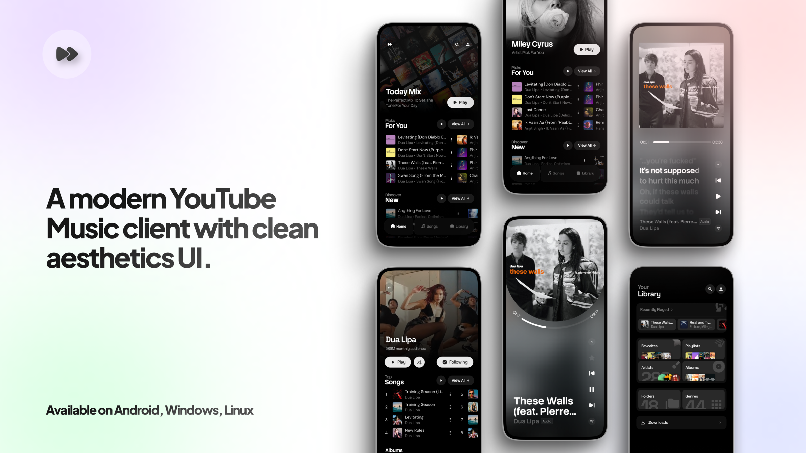

# Looper Music v3.1.0

A redesign release: a new Lyrics screen that follows your Now Playing style, a new Equalizer, a customizable Library, playlist import from every common format, locked backups and a new audio engine.

  

## Download

Not sure which phone type you have? Take `arm64-v8a`.

| Phone type | APK |
|---|---|
| `arm64-v8a` (most phones) | [Download](https://github.com/devvlooper/LooperMusic/releases/download/3.1.0/looper-player-v3.1.0-arm64-v8a-online-release.apk) |
| `armeabi-v7a` | [Download](https://github.com/devvlooper/LooperMusic/releases/download/3.1.0/looper-player-v3.1.0-armeabi-v7a-online-release.apk) |
| `x86_64` | [Download](https://github.com/devvlooper/LooperMusic/releases/download/3.1.0/looper-player-v3.1.0-x86_64-online-release.apk) |
| `universal` | [Download](https://github.com/devvlooper/LooperMusic/releases/download/3.1.0/looper-player-v3.1.0-universal-online-release.apk) |

## What's New

### New
- **New Lyrics screen** that follows your Now Playing style: Arc gets an arched seek bar with the controls inside it, Linear and Card get their seek row, Classic keeps its wavy bar
- The lyrics top bar (close, lyrics source, menu) hides when you leave the screen alone; the song moves up and a favorite button takes the menu's place
- New lyrics menu, tips guide and share sheet
- **New Equalizer**: All songs / This song switcher, presets as chips, an 18-band card with a Reset button, and every effect in one list that opens its settings when you turn it on
- **Import playlists** from M3U, M3U8, PLS, XSPF, WPL, ZPL, SMIL, MPC-HC and AIMP files, with a new Import button on the Playlists page
- **Customize Library**: pin playlists, Favorites or Downloads to the top of Library and drag them into order
- **Locked backups**: add a password to encrypt a backup and include your signed-in account, so restoring it signs you in again
- Backups now include your app settings; restoring asks before replacing yours
- **Show cached songs in Songs**: online songs saved whole in the cache appear in Songs and play without loading (Music Management)
- **Pill Music Bar** and **Frosted Music Bar**: the 2.7 pill shape with round artwork and a lighter frosted background, on by default (Player Interface)
- A new add-to-queue icon
- **Follow Now Playing Background** for Lyrics, on by default: the lyrics screen uses the same background as Now Playing. Turn it off to get the lyrics gradient and blurred artwork options back (Lyrics)
- **Photo in Top Bars**: your profile photo on Home, Songs and Library instead of the person icon; signing in saves your account photo when you have none (Account)

### Improved
- New audio engine (mpv_audio_kit 0.8): equalizer slider drags apply live, without a dropout
- Built-in EQ presets are half as strong; Bass Booster no longer overpowers the mix
- The artwork and seek bar glide between Now Playing and Lyrics on every player style, Fluid Player included
- Swiping to change songs blurs the cover through the change instead of flashing
- Playlists: New Playlist and Import buttons at the top instead of floating buttons
- Music video artwork zooms in past the black cinema bars
- The backup picker finds backup files whatever their file type
- With Dynamic Color Active Line off, white replaces the accent across the lyrics screen and its menu, and the settings show a preview of the white line
- The Accent Color Active Line toggle is gone: the Intensity slider sets how much color the active line has
- Opening Lyrics no longer flashes dark before the blurred cover shows. When following Now Playing, the lyrics fade out above the controls instead of sitting on a dark band
- Every setting is translated into all 14 languages
- With Manage Audio Focus off, Looper plays alongside other apps instead of pausing them
- Quick Play continues after a call

### Fixed
- A call during a crossfade now pauses both songs
- Resume on Bluetooth Connect never starts music during a call, or after you paused from the headset just before switching it off
- Wide covers are no longer squashed in song lists
- Always Blur Sheets now applies to the song menu, the Now Playing menu, song details, sleep timer and sort sheets, Pure Black included
- Only a song the call paused resumes when it ends; a song you paused stays paused, Bluetooth calls included
- With Manage Audio Focus off, Looper could go silent after another app played while still showing as playing
- Crossfading to the next song no longer drops audio focus for a moment, so calls and other apps are still handled
- Resume after Call also works for calls on a Bluetooth headset
- Resume on Bluetooth Connect stays off while Manage Audio Focus is off
- The notification's buttons no longer change after a pause

## Support

If you enjoy Looper, you can support us on Ko-fi:

## Notes

This release is distributed through GitHub and Play Store. Verify downloads with the `SHA256SUMS-v3.1.0.txt` file.

**Full Changelog**: https://github.com/devvlooper/LooperMusic/compare/3.0.3...3.1.0
